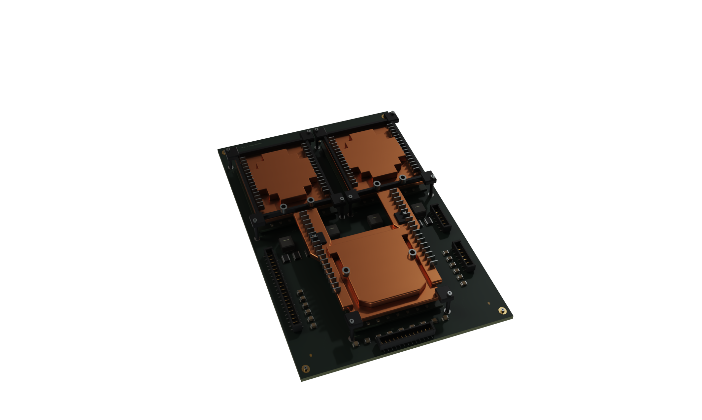

# Phase 5 — Cycles 前段與互動 Rack 交接可行性

結論：**B／離線影片方案目前 NOT ADOPTED。** 已完成真實 Cycles 單幀實驗，證明目前 WebGL 的座標與相機可以精確轉移；尚未證明兩個 renderer 的光度、完整場景或連續影格交接等價。既有動畫、production renderer 與互動沒有改動。這張離線圖不計入 Phase 5 的照片級分數，也不冒充四組 Chromium Before／After 的其中一張。

## 實際完成的最小實驗

工具：[cycles_camera_probe.py](../assets/l10-prototype/experiments/cycles_camera_probe.py)。輸出保存在 ignored `artifacts/l10-phase5/offline/`；執行環境與輸入方式見 [experiment README](../assets/l10-prototype/experiments/README.md)。

| 項目 | 實際資料 |
| --- | --- |
| 硬體資產 | 凍結 Phase 4 `031830a1c7faf5484b358e0964551e8656e1d852` 的單板 GLB，8 個 mesh nodes、59,664 triangles |
| GLB SHA-256 | `c8467c0ac186b34ee95e549fc27f5da47ad3de4b8d09b72b68d6070e774985cc` |
| 參考場景 | Phase 4 `03-cooling`，progress `0.354`，約第 `12.4608` 秒；所有組装 layer lift = 0 |
| 相機 | 直接使用既有實測 eye、target、vertical FOV `0.5` radians；沒有重新取景 |
| 幾何變換 | 既有 raw pose `(-5.3, 4.65, 7)`，共同 scale `(.688, 1, .802)`，再做 glTF Y-up → Blender Z-up 軸轉換 |
| 實際 render 範圍 | **2127×1272 WebGL canvas 對應畫幅中的一片板**，RGBA 透明背景；未渲染整個 3440×1440 網頁、第二片板、機殼、既有外部管線或 Rack |
| Renderer | Blender 4.5.9 LTS／Cycles CPU，8 threads，32 samples，8 bounces，固定 seed，denoising 開啟 |
| 光源 | 同一份 Studio Small 09 HDR、原 source exposure `0.38`；新增攝影燈數量 **0** |
| 色彩輸出 | 保留 scene-linear EXR；PNG 使用既有 GLSL `displayTransform` 的 rational curve 與 `pow(1/2.2)`，沒有 AgX、額外曝光或對比調整 |
| 資產匯入耗時 | `0.435 s`，本機磁碟／Blender import，**不是瀏覽器下載時間** |
| 單幀渲染及 EXR 寫入 | **31.110 s**；不是即時 FPS，也不是完整片段平均成本 |
| PNG | **564,760 bytes**，`cooling-cycles-existing-display.png` |
| 線性 EXR | **5,431,559 bytes**，`cooling-cycles-linear.exr` |
| 輸出影像 SHA-256 | PNG `4ee891c9829022febaf6374c6b09c2b59a9c5be80ea8df53283a54a0618c4d62` |
| 最大相機投影誤差 | **0.000270 canvas pixel**，8 個 landmark；工具要求小於 `0.01 px` 才允許 render |

相機投影檢查包含四個 PCB 角落、CPU 與兩個 GPU 接觸中心、CPU collar 頂端。以既有 WebGL Float32 perspective/lookAt 計算投影，與 Blender `world_to_camera_view` 逐點比较；完整座標與每點誤差在 `probe-result.json`。此證據確認單幀的數學投影，而非硬體尺寸正確性，也不代表時間軸速度已匹配。

可攜驗證資料：[8 個定位點與輸出量測](screenshots/l10-cinematic/phase5/evidence/cycles-probe-result.json)。線性 EXR 與 probe Blender 檔留在本機 ignored artifacts，不作為 production 資產。

## 光度不等價的具體原因

既有 WebGL shader 不是一個可以直接用瓦數重建的純攝影棚。`app/static/js/core-scene.js` 除 HDR split-sum IBL 外，還加入以下材質相關項目：

| WebGL 項目 | Cycles probe 狀態 |
| --- | --- |
| Key diffuse `× .82`、GGX conductor specular `× .48` | 未臆造對應燈瓦數；未複製此非物理組合 |
| 固定前方 diffuse fill `× .22` | 未另加燈光 |
| 後方 service reflection lobe `× .42`、diffuse `× .35` | 未另加燈光 |
| 最終 shader radiance `× .91` | Cycles 保留原 HDR exposure，未利用亮度校正來追平截圖 |
| 512×256 GGX 預積分、log RGB strip 編碼與粗糙度插值 | Cycles 使用來源 HDR 與實際 path tracing；BRDF 積分、取樣及間接反射不同 |
| 2048 shadow map／9-tap filtering | Cycles 光線可見性與接觸陰影不同 |
| 原場景周圍機殼／另一片板／外部管線遮擋 | 單板 probe 未載入這些原場景物件 |

環境方向以 shader 的 UV 算式明確轉譯；同一 HDR 與同一 tone curve **不等於**兩個光照解算器相同。沒有對這張圖與全場景 Chromium screenshot 計算誤導性的全圖 PSNR／亮度優劣，因為可見幾何與遮擋物範圍並不相同。

實際檢視 PNG：Cycles 中銅蓋較暗、表面反射較克制，固定件有更深的接觸遮蔽；原本厚而規則的金屬鰭片、稀疏 PCB、近似冷板外形仍清楚存在。切換成 Cycles 沒有補出缺少的機構證據或真實材質。不能以這種布光差異宣稱幾何、照片級分數或整體品質提升。

## A／B 比較

以下是此實驗與目前程式的工程評估；影片容量與下載延遲尚未實测，沒有把推算當成成果。

| 面向 | A：既有 Real-Time WebGL + GLB | B：Cycles 離線前段 + WebGL Rack |
| --- | --- | --- |
| 照片級潛力 | 精確資產、材質與既有 shader 的上限；現有 shadow map、IBL 與近似 BRDF 仍有限制 | Path tracing 可處理更完整的光傳輸、接觸與多次反射；實際硬體資產與照片證據的不足仍在 |
| 傳輸容量 | 本次凍結 GLB `7,768,444 B`；使用一次後可重複視角、Replay 與互動 | 已測單張 PNG `564,760 B`／EXR `5,431,559 B`；未製作影片，無實測 MP4/WebM 容量。要維持交接後相同資產，影片外仍需 WebGL 場景／GLB |
| 顯存與資源 | Phase 4 一板貼圖配置估算 `116 MiB`，vertex buffer `8.19 MiB`，另有完整既有場景 | 需影片 decode buffers，加上交接時已預熱的 WebGL。未測 codec、alpha、解碼器或雙管線峰值記憶體 |
| 載入延遲 | 需下載、解碼貼圖及上傳 GPU；此研究未另測網路 cold-start | 需拿到可解碼影格與預載交接場景，弱網路或解碼停頓會影響時鐘；不可把本機 Blender import `0.435 s` 當影片啟動延遲 |
| 轉場 | 單一 renderer、既有同一相機／物件／time state；已具回歸測試 | 座標單幀可匹配，光度目前不匹配；codec 色彩、曝光、陰影、alpha、DOM裁切、時鐘及速度均有跳變風險 |
| 自由互動 | 同一模型可 Orbit／Rear／Reset、雙向 seek、Skip／Replay | 影片前段鎖定相機、比例與內容；任意 orbit／seek 若需即時回退，必須維持第二套完整等價渲染 |
| 製作成本 | 每次修改資產匯出 GLB 並重跑瀏覽器測試 | 每次模型／材質／攝影機／畫幅改動都需重烘前段、編碼、檢查接縫與不同裝置的影片色彩 |
| 工程可行性 | 已存在的整合管線，Phase 5 可繼續只改善 opt-in 單板 | 現在尚不具備可驗證的 seamless handoff；不採用，不改35.2秒動畫 |

例如若離線範圍延伸到現有 bridge 結束 `p=.56`，時長為 `19.712 s`，不是另一支重新編排的電影。若採 30 fps，約需 592 幀；單板一幀的測試無法認證完整場景每幀成本或最終壓縮量。本研究沒有執行全片渲染，以免把未能匹配的 pipeline 擴大製作。

## 尚未完成的交接條件

目前沒有影片、沒有 video→canvas swap、沒有交接前後連續影格，故結果不能寫成「已無縫銜接」。若未來重新評估 B，至少需要：

1. 從既有 controller 輸出完整 geometry state、camera eye/target、damping history、layer transforms 與 renderer exposure，而不是另寫一套時間線。
2. 同時保留完整遮擋場景、相同材質與通過對照的光照解算；現在的非物理補光項目是實質阻礙。
3. 在交接點同時檢查位置與速度，包含所有 moving tray、Camera Bridge 和 U40 state；本次單幀投影只有位置證據。
4. 預載 GLB／貼圖、等 WebGL 真正 ready，並使用實際解碼影格的 media timestamp，而不是 `setTimeout` 假設影片幀已呈現。
5. 對固定畫幅、不同 aspect ratio／DPR、color conversion、透明邊界、掉幀、慢網路、Skip／Replay／Reduced Motion 做連續影格回歸，且不得再次執行 U40 插入。

`requestVideoFrameCallback()` 可提供解碼影格的 `mediaTime` 與 `expectedDisplayTime`，但並不保證 callback 與畫面嚴格同步；所以它是驗證工具的一部分，不是無縫保證。[MDN API 文件](https://developer.mozilla.org/en-US/docs/Web/API/HTMLVideoElement/requestVideoFrameCallback)

Blender 的 Raw／EXR 與 view transform 是不同層次；本實驗選擇保留線性資料並使用原 WebGL display transfer，避免用不同 tone mapping 產生假改善。[Blender Color Management](https://docs.blender.org/manual/en/3.6/render/color_management.html)

下一步仍應優先 A：把同一片板的可見幾何與材質做對，以相同 Chromium 條件驗收。B 本次只確認了座標可移植性；未排除交接品質風險，不建議擴充或替換現有動畫。
